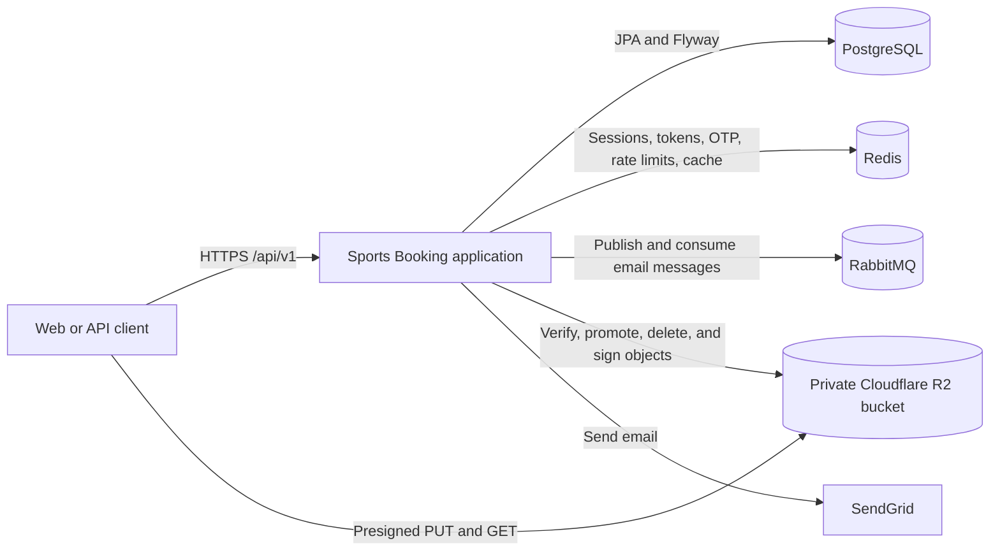
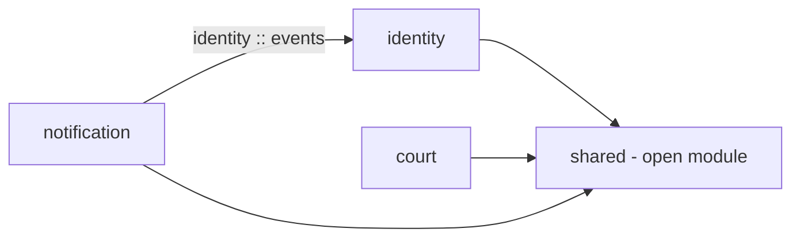
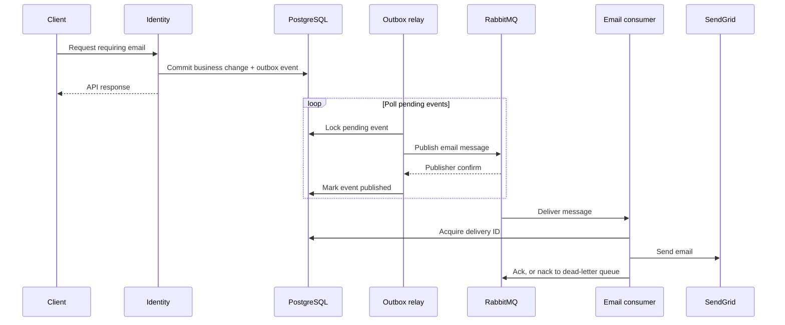

# System Architecture

This document describes the architecture implemented in the current backend. It is intended for engineers changing module boundaries, persistence, authentication, email delivery, or image storage. HTTP contracts and field-level business rules belong in the [API documentation](../api/README.md).

## 1. Scope and architectural style

Sports Booking is a **Spring Boot modular monolith**. One application process serves the HTTP API and runs scheduled/background workers. Spring Modulith defines and verifies the module boundaries; it does not deploy the modules as separate services.

The implemented product scope is identity and access management, court discovery and provider management, outbound email notifications, and shared image uploads. Court schedules describe operating hours, prices, and closures. **Reservations, payment, and booking availability are not implemented yet.** In particular, an open schedule slot is not a reservation guarantee.

The application uses Java 21, Spring Boot, Spring Data JPA, Spring Security, Flyway, PostgreSQL, Redis, RabbitMQ, SendGrid, and Cloudflare R2. R2 can be disabled by configuration; the upload initiation endpoint then returns an unavailable error.

## 2. System context



The diagram shows logical communication, not deployment topology. The API, outbox relay, upload cleanup task, and RabbitMQ listener run in the same application. The repository's [Docker Compose file](../../docker-compose.yml) starts PostgreSQL, Redis, and RabbitMQ for local development; it does not deploy the application, R2, or SendGrid.

### Data ownership

| Store | Responsibility | Persistence model |
| --- | --- | --- |
| PostgreSQL | Users, roles, permissions, courts, schedules, prices, closures, image metadata, upload assets, outbox events, and processed email deliveries | System of record; schema changed through Flyway migrations |
| Redis | Session state, refresh-token hashes, token versions and blacklist, verification tokens, OTPs, pending permission changes, rate limits, and user-details cache | Expiring operational state; required by current authentication flows |
| RabbitMQ | Email delivery queue and dead-letter queue | Message transport; not the source of business data |
| Cloudflare R2 | Staged and attached image bytes | Private object storage; PostgreSQL holds the corresponding metadata |

## 3. Modules and dependency rules

The root package is `dev.booking.sports`. Each top-level module is declared in its `package-info.java`; [ArchitectureTest](../../src/test/java/dev/booking/sports/ArchitectureTest.java) calls `ApplicationModules.verify()` to check the Spring Modulith structure. See [Module Boundaries](./module-boundaries.md) for ownership and the public interfaces between modules.



| Module | Owns | Entry points and dependencies |
| --- | --- | --- |
| `identity` | Accounts, credentials, RBAC, JWT/session lifecycle, verification and OTP flows | Auth/user/role/permission controllers; depends on `shared` |
| `court` | Sports catalog, court lifecycle, operating hours, price rules, closures, schedules, and gallery | Public and provider court controllers; depends on `shared` |
| `notification` | Email templates, queue publication, consumer, SendGrid adapter, and delivery deduplication | Consumes `identity :: events` and uses `shared` outbox infrastructure |
| `shared` | API envelopes, errors, persistence helpers, rate limiting, outbox infrastructure, and upload protocol | An **open** Spring Modulith module used by the feature modules |

`identity.domain.event` is the named `events` interface exposed to `notification`. `court` supplies `CourtImageUploadPolicy` to the shared upload service as a Spring bean; the upload service receives the `UploadPolicy` interface and does not import court classes. Court image management calls `UploadService` to claim, release, and read assets.

Within a feature module, `api` contains controllers and request/response DTOs, `application` contains use cases and policies, and `domain` contains models and repository interfaces. Identity also has `infrastructure` adapters for Redis and security. Changes should keep HTTP DTOs out of domain logic, put business rules in the owning module, and avoid direct imports across feature modules except for an explicitly exposed interface such as `identity :: events`. If a new module needs a shared capability, define a narrow contract rather than depending on another module's internal repository or entity.

## 4. Synchronous request path

1. Spring Security receives the request. `JwtAuthenticationFilter` parses an access token when a bearer header is present and checks token version and blacklist state in Redis.
2. `SecurityConfig` allows explicitly public routes and requires authentication elsewhere. Method-level role/permission checks protect restricted operations.
3. A controller validates and maps the request, then calls an application service. The service enforces ownership and business rules and uses JPA repositories or a shared service.
4. JPA persists business data in PostgreSQL. Flyway migrations define the schema; Hibernate uses `ddl-auto: validate` in the configured environments.
5. Controllers return the shared success envelope where applicable. `GlobalExceptionHandler` maps failures to the API error format. Some successful operations return `204 No Content`.

See [API conventions](../api/api-conventions.md) for URL versioning, pagination, authentication headers, response shapes, and status codes.

### Authentication and authorization

Identity issues signed access and refresh JWTs. Access tokens carry user ID, session identifier, token version, roles, and permissions. The API does not trust the JWT signature alone: the request filter consults Redis so logout and account-wide revocation can take effect before access-token expiry. Refresh tokens are associated with a Redis-backed device session and rotated; replay of an old refresh token revokes all sessions for that user. User accounts, roles, and permissions remain in PostgreSQL. See the [Identity API](../api/modules/identity-api.md) for user-facing flows.

## 5. Asynchronous email delivery

Identity writes email intents through the shared `OutboxService`. When called inside a business transaction, the business changes and outbox row commit together in PostgreSQL. Email dispatch runs independently of the HTTP response, so a successful API response means the work was accepted, not that the recipient has received a message.



The relay selects pending rows with `FOR UPDATE SKIP LOCKED`, routes each event through an `OutboxPublicationHandler`, waits for a RabbitMQ publisher confirm, and records publication or retry state. After the configured maximum attempts, the outbox event becomes `FAILED`. The email consumer uses the outbox event ID in `processed_email_deliveries` to suppress duplicate processing. A delivery exception releases that record and sends the message to `sports.notification.email.dlq` via a negative acknowledgement without requeueing.

This uses **at-least-once message transport with application-level deduplication**, not an end-to-end exactly-once email guarantee. A crash around broker publication, delivery-record acquisition, or a remote send can leave an ambiguous outcome; acquiring a deduplication record before the send also means some failures can suppress a later redelivery. Operators should inspect both failed outbox events and the email dead-letter queue; the application does not currently expose a replay API. Queue names and routing keys are defined in `NotificationRabbitConfig`.

## 6. Image upload and court gallery

The shared upload subsystem issues presigned R2 URLs and owns `upload_assets` metadata. It separates browser-writable staging objects from verified permanent objects.

```mermaid
sequenceDiagram
    participant Client
    participant API as Upload API
    participant DB as PostgreSQL
    participant R2
    participant Court as Court module
    Client->>API: Initiate upload (purpose, resource, metadata)
    API->>Court: UploadPolicy authorizes owner and capacity
    API->>DB: Create PENDING upload asset
    API-->>Client: Presigned PUT URL and required headers
    Client->>R2: PUT image to staging key
    Client->>API: Complete upload
    API->>R2: Check metadata and read bytes
    API->>API: Validate image content and dimensions
    API->>R2: Conditional copy to assets key
    API->>DB: Mark asset READY
    Client->>Court: Attach image using upload ID
    Court->>API: Claim asset in same DB transaction
    Court->>DB: Save gallery entry; asset ATTACHED
```

The current purpose is `COURT_IMAGE`. A policy in `court` checks provider ownership and gallery capacity. `UploadService` locks the upload row when completing or claiming it, and the claim participates in the court transaction. A read URL is issued only after the consuming module authorizes access. Deleting an image releases the asset for cleanup. A scheduled task removes expired or deletion-pending assets when R2 is enabled. The R2 bucket must remain private and its staging lifecycle/CORS configuration must match the [Upload API requirements](../api/modules/upload-api.md).

Object storage and PostgreSQL do not share a transaction. The upload lifecycle and cleanup task handle abandoned or expired objects; changes to this flow must account for partial failures between R2 and database operations. `LegacyImageReader` still supports older gallery records without an upload ID.

## 7. Runtime and change guidance

- **Configuration:** `application.yml` supplies common defaults; `application-dev.yml`, `application-test.yml`, and `application-prod.yml` select environment-specific connections and behavior. Environment variables supply credentials and endpoints. Use [.env.example](../../.env.example) as the variable inventory; do not commit real secrets.
- **Schema:** add a versioned script under `src/main/resources/db/migration` for persistent data changes. Both development and production enable Flyway and validate the JPA mapping against the migrated schema.
- **Background work:** the outbox relay polls on `app.outbox.poll-interval`; upload cleanup runs only when R2 is enabled. The test profile disables automatic outbox relay and RabbitMQ listener startup so tests can control those paths.
- **Verification:** run the module boundary test when changing dependencies, focused tests for the affected use case, and the CI build. [CI](../../.github/workflows/ci.yml) runs Maven verification against PostgreSQL, Redis, and RabbitMQ services and has a separate Testcontainers integration job.
- **API changes:** update the [module API docs](../api/README.md), shared conventions or error catalog when behavior changes. Keep this document focused on component responsibilities and cross-component flows rather than duplicating endpoint details.

The current repository has health/info Actuator endpoints, but does not contain production deployment manifests, monitoring dashboards, backup procedures, or an incident runbook. Those operational concerns require environment-specific documentation before production deployment.
