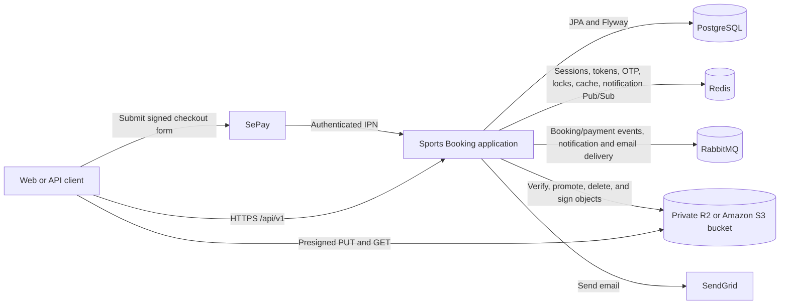

# System Architecture

Runtime components and transaction boundaries of the backend. HTTP contracts belong in the [API reference](../api/README.md); Java dependencies and ownership are defined in [module boundaries](module-boundaries.md).

## 1. Scope and architectural style

Sports Booking is a **Spring Boot modular monolith**. One application process serves the HTTP API and runs scheduled/background workers. Spring Modulith defines and verifies the module boundaries; it does not deploy the modules as separate services.

The implemented product scope includes identity and access management, court discovery and provider management, inbox/email notifications with SSE hints, shared image uploads, booking holds/queries/cancellation/completion, SePay checkout and IPN settlement, and completed-booking reviews. Court schedules describe operating hours, prices, and closures; booking creation checks occupancy before committing a hold. **Manual payment reconciliation, admin refund operations, and booking-aware public availability are not implemented yet.** An open schedule slot is not a reservation guarantee.

The application uses Java 21, Spring Boot, Spring Data JPA, Spring Security, Flyway, PostgreSQL, Redis, RabbitMQ, SendGrid, and Cloudflare R2 or Amazon S3. Both storage providers can be disabled by configuration; upload initiation then returns an unavailable error.

## 2. System context



The diagram shows logical communication, not deployment topology. The API, outbox relay, upload cleanup task, and RabbitMQ listener run in the same application. The repository's [Docker Compose file](../../docker-compose.yml) starts PostgreSQL, Redis, and RabbitMQ for local development; it does not deploy the application, object storage, or SendGrid.

### Data ownership

| Store | Responsibility | Persistence model |
| --- | --- | --- |
| PostgreSQL | Users, roles, permissions, courts, schedules, prices, closures, bookings, booking slots/history, payments/attempts/receipts/inbox/refund records, reviews, notifications, image metadata, upload assets, outbox events, and processed email deliveries | System of record; schema changed through Flyway migrations |
| Redis | Session state, refresh-token hashes, token versions and blacklist, verification tokens, OTPs, pending permission changes, rate limits, slot/idempotency locks, user-details cache, and best-effort notification Pub/Sub | Expiring operational state; required by current authentication flows |
| RabbitMQ | Booking/payment exchanges and event queues, booking-notification and payment-cancellation queues, email delivery, retries, and dead-letter queues | Message transport; not the source of business data |
| Cloudflare R2 / Amazon S3 | Staged and attached image bytes | Private object storage; PostgreSQL holds metadata and the provider for each asset |

## 3. Modules and dependency rules

The root package is `dev.booking.sports`. Spring Modulith verifies `package-info.java`
dependency declarations through [ArchitectureTest](../../src/test/java/dev/booking/sports/ArchitectureTest.java).
The [module boundaries](module-boundaries.md) reference defines ownership and named interfaces.

Most feature modules use `api`, `application`, `domain`, and infrastructure packages.
The compact `review` module keeps its classes at the module root. Business rules and
persistence remain in the owning module; cross-module access uses public contracts.

## 4. Synchronous request path

1. Spring Security receives the request. `JwtAuthenticationFilter` parses an access token when a bearer header is present and checks token version and blacklist state in Redis.
2. `SecurityConfig` allows explicitly public routes and requires authentication elsewhere. Method-level role/permission checks protect restricted operations.
3. A controller validates and maps the request, then calls an application service. The service enforces ownership and business rules and uses JPA repositories or a shared service.
4. JPA persists business data in PostgreSQL. Flyway migrations define the schema; Hibernate uses `ddl-auto: validate` in the configured environments.
5. Controllers return the shared success envelope where applicable. `GlobalExceptionHandler` maps failures to the API error format. Some successful operations return `204 No Content`.

See [API conventions](../api/api-conventions.md) for URL versioning, pagination, authentication headers, response shapes, and status codes.

### Authentication and authorization

Identity issues signed access and refresh JWTs. Access tokens carry user ID, session identifier, token version, roles, and permissions. The API does not trust the JWT signature alone: the request filter consults Redis so logout and account-wide revocation can take effect before access-token expiry. Refresh tokens are associated with a Redis-backed device session and rotated; replay of an old refresh token revokes all sessions for that user. User accounts, roles, and permissions remain in PostgreSQL. See the [Identity API](../api/modules/identity-api.md) for user-facing flows.

## 5. Asynchronous email delivery

Identity writes email intents through the shared `OutboxService`. When called inside a business transaction, the business changes and outbox row commit together in PostgreSQL. Email dispatch runs independently of the HTTP response, so a successful API response means the work was accepted, not that the recipient has received a message.

```mermaid
sequenceDiagram
    participant Client
    participant Identity
    participant DB as PostgreSQL
    participant Relay as Outbox relay
    participant MQ as RabbitMQ
    participant Consumer as Email consumer
    participant SendGrid
    Client->>Identity: Request requiring email
    Identity->>DB: Commit business change + outbox event
    Identity-->>Client: API response
    loop Poll pending events
        Relay->>DB: Lock pending event
        Relay->>MQ: Publish email message
        MQ-->>Relay: Publisher confirm
        Relay->>DB: Mark event published
    end
    MQ->>Consumer: Deliver message
    Consumer->>DB: Insert delivery ID in transaction (unique constraint)
    Consumer->>SendGrid: Send email
    Consumer->>DB: Commit on success; rollback on failure
    Consumer->>MQ: Confirm retry/DLQ publication on failure; then ack
```

The relay locks pending rows, publishes through an `OutboxPublicationHandler`, and
marks publication only after successful routing and publisher confirmation. Failed
publications remain retryable and eventually require operator replay.

The email consumer inserts the event ID into `processed_email_deliveries` and calls
SendGrid in the same database transaction, acknowledging after commit. This provides
at-least-once delivery with deduplication. If SendGrid accepts an email but the database
commit fails, redelivery may send a duplicate. Retry queues, limits and recovery
endpoints are documented in [RabbitMQ operations](../guides/rabbitmq-operations.md).

## 6. Image upload and court gallery

The shared upload subsystem issues presigned R2/S3 URLs and owns `shared_upload_assets` metadata. It separates browser-writable staging objects from verified permanent objects. `ObjectStorageRegistry` selects the configured default for new uploads; each asset persists its provider for later completion, reads, and deletion. Both adapters share the S3-compatible operations with separate clients, presigners, buckets, and credentials.

```mermaid
sequenceDiagram
    participant Client
    participant API as Upload API
    participant DB as PostgreSQL
    participant Storage as R2 or Amazon S3
    participant Court as Court module
    Client->>API: Initiate upload (purpose, resource, metadata)
    API->>Court: UploadPolicy authorizes owner and capacity
    API->>DB: Create PENDING upload asset
    API-->>Client: Presigned PUT URL and required headers
    Client->>Storage: PUT image to staging key
    Client->>API: Complete upload
    API->>Storage: Check metadata and read bytes
    API->>API: Validate image content and dimensions
    API->>Storage: Conditional copy to assets key
    API->>DB: Mark asset READY
    Client->>Court: Attach image using upload ID
    Court->>API: Claim asset in same DB transaction
    Court->>DB: Save gallery entry; asset ATTACHED
```

The current purpose is `COURT_IMAGE`. A policy in `court` checks provider ownership and gallery capacity. `UploadService` locks the upload row when completing or claiming it, and the claim participates in the court transaction. A read URL is issued only after the consuming module authorizes access. Deleting an image releases the asset for cleanup. A scheduled task removes expired or deletion-pending assets for enabled providers. Each bucket must remain private and its staging lifecycle/CORS configuration must match the [Upload API requirements](../api/modules/upload-api.md). See the [S3 setup guide](../guides/s3-upload.md).

Object storage and PostgreSQL do not share a transaction. The upload lifecycle and cleanup task handle abandoned or expired objects; changes to this flow must account for partial failures between storage and database operations. `LegacyImageReader` still supports older gallery records without an upload ID.

## 7. Payment, completion, reviews, and inbox notifications

The browser submits the server-signed SePay form; checkout creation does not collect
money. Authenticated IPNs commit to a PostgreSQL inbox before acknowledgement. A
leased worker validates financial facts and locks booking before payment, then
settles payment, confirms booking/slots, and writes lifecycle outbox events in one
transaction. Settlement grace retains pending-payment slots briefly for an on-time
receipt; late or anomalous receipts require review. Cancellation events asynchronously
cancel pending payments without initiating gateway refunds. See the
[Payment API](../api/modules/payment-api.md) and [database contract](../payment-schema.md).

A provider owning every court, or an admin, can complete a confirmed booking after
all slots end. Customers may then create one review for that booking. Review owns
comments, ratings, provider replies, and moderation; eligibility and court ownership
are obtained through public facades. See [Review API](../api/modules/review-api.md).

A notification-owned RabbitMQ consumer creates customer inbox entries and booking
email intents from confirmed/cancelled/expired events. Inbox writes and email intents
commit together; duplicate deliveries do not create another entry or intent. REST is
the source of inbox state. After-commit Redis Pub/Sub delivers best-effort SSE hints
across instances; reconnecting clients must resynchronize through REST because hints
have no durable replay. See [Notification API](../api/modules/notification-api.md).

## 8. Runtime configuration

- Environment profiles select connections and credentials; see [local development](../guides/local-development.md).
- Persistent changes use versioned Flyway migrations under `src/main/resources/db/migration`; Hibernate validates the resulting schema.
- The outbox relay has a dedicated scheduler. Booking expiry, payment inbox processing and upload cleanup run as background jobs.
- [CI](../../.github/workflows/ci.yml) runs Maven verification and a separate Testcontainers integration job.
