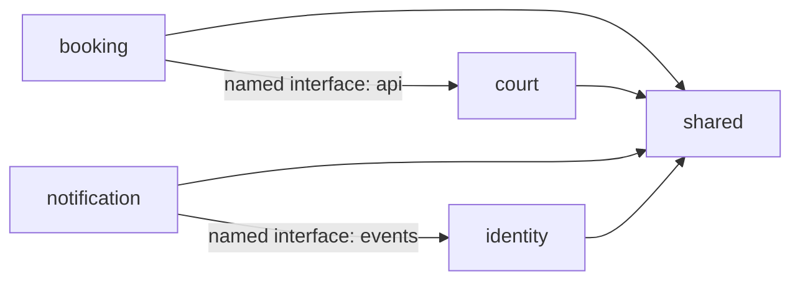

# Module Boundaries

This document defines who owns each capability and which interfaces other parts of the application may use. It describes the code as implemented today. For the deployment view and end-to-end flows, see [System Architecture](./architecture.md). For HTTP request/response details, see the [API documentation](../api/README.md).

## What "public API" means here

There are two different interfaces:

1. **HTTP API:** routes exposed to clients through Spring controllers. A public HTTP route does not make its controller, DTO, or repository a Java API for other modules.
2. **In-process API:** types that another module is allowed to import or implement. Spring Modulith enforces module dependencies declared in `package-info.java`. The named feature-module interfaces are `identity :: events` and `court :: api`; `shared` is an open module. A Java `public` modifier alone is not a promise of cross-module stability.

The application is one process and one build artifact. These boundaries control coupling and ownership; they are not network service boundaries.

## Dependency policy

| Calling module | Allowed dependencies | Disallowed direct dependency examples |
| --- | --- | --- |
| `identity` | `shared` | `court`, `booking`, `notification` internals |
| `court` | `shared` | `identity`, `booking`, `notification` internals |
| `booking` | `shared`, `court :: api` | `identity`, other `court` packages, and `notification` internals |
| `notification` | `shared`, `identity :: events` | Other `identity` packages; `court` and `booking` internals |
| `shared` | No feature module | `identity`, `court`, `booking`, `notification` implementation classes |

These are the `allowedDependencies` declarations in [identity](../../src/main/java/dev/booking/sports/identity/package-info.java), [court](../../src/main/java/dev/booking/sports/court/package-info.java), [booking](../../src/main/java/dev/booking/sports/booking/package-info.java), and [notification](../../src/main/java/dev/booking/sports/notification/package-info.java). [Shared](../../src/main/java/dev/booking/sports/shared/package-info.java) is declared `OPEN`; that makes its subpackages available to other modules, but callers should still use the smallest relevant contract. [ArchitectureTest](../../src/test/java/dev/booking/sports/ArchitectureTest.java) runs `ApplicationModules.verify()` to check the declared structure.

## Module contracts

### `identity` — accounts and access

**Owns:** user lifecycle, credentials, email verification, password and OTP flows, roles and permissions, JWT issuance, session revocation, and Redis-backed authentication state. Its persistent model includes users, roles, permissions, and their relationships.

**HTTP API:** `/api/v1/auth`, `/api/v1/users`, `/api/v1/roles`, and `/api/v1/permissions`. The [Identity API](../api/modules/identity-api.md) is the client contract.

**In-process API:** [identity.domain.event](../../src/main/java/dev/booking/sports/identity/domain/event/package-info.java) is explicitly named `identity :: events`. It contains the event payload records and `IdentityOutboxMessageTypes` used by `notification` to interpret identity email intents. Event type and version are part of this integration contract; changing a payload or event type requires updating the publishing and consuming sides together. No general-purpose user lookup or RBAC facade is currently exposed to other feature modules.

**Boundary rules:** identity owns user status and permission decisions. Another module must not modify identity tables or import `UserRepository` to make its own authorization decision. The court module stores an owner UUID and obtains the acting user from the authenticated principal; it does not hold a JPA relationship to the identity `User` entity.

### `court` — catalog and court management

**Owns:** sports catalog, court profile and lifecycle, provider ownership checks, operating hours, price rules, closures, schedule calculation, search, and gallery metadata. Its persistent model includes sports, courts, hours, price rules, closures, and court images.

**HTTP API:** `/api/v1/sports`, `/api/v1/courts`, and `/api/v1/provider/courts`, including their subresources. The [Court API](../api/modules/court-api.md) is the client contract. A schedule slot describes configured time and price; booking availability is outside the implemented scope.

**In-process API:** `court :: api` exposes `CourtFacade` for provider ownership checks and quoted, bookable schedule slots. It exposes immutable values rather than court entities. Court also integrates with shared uploads by implementing `UploadPolicy` in `CourtImageUploadPolicy` for purpose `COURT_IMAGE`, and by calling `UploadService` to claim, release, and read assets.

**Boundary rules:** court owns the meaning of `COURT_IMAGE`, the resource ownership check, gallery capacity, and which image belongs to which court. Upload storage mechanics and upload-asset state are owned by `shared`. New consumers should not import court repositories or use court entities as a shortcut for a separate capability.

### `booking` — reservation lifecycle and court occupancy

**Owns:** booking holds, selected booking slots, price snapshots, booking state transitions, idempotency identity, expiry metadata, and booking status history. PostgreSQL exclusion constraints prevent active slots for the same court from overlapping.

**HTTP API:** one resource-oriented controller owns `/api/v1/bookings`. `POST /api/v1/bookings` creates a temporary hold with a required idempotency key. `GET /api/v1/bookings/me` returns the current customer's paginated history. `GET /api/v1/bookings` lets admins list all matching bookings and limits providers to bookings whose courts they fully own. `GET /api/v1/bookings/{id}` returns one accessible booking. `POST /api/v1/bookings/{id}/cancellations` cancels an accessible booking with version checking.

**Integration API:** booking consumes only `court :: api` for provider ownership authorization. The named `booking :: events` interface exposes immutable held, confirmed, cancelled, and expired event payloads. `BookingOutboxMessageTypes` owns their aggregate type, event names, and contract version so publishers and consumers do not duplicate string literals. `BookingOutboxPublicationHandler` validates stored payloads and publishes a versioned envelope to the durable `sports.booking.events` RabbitMQ topic exchange, using the event type as its routing key. Each logical consumer must bind its own durable queue and deduplicate deliveries by `eventId`. Each payload carries booking/customer identity, monetary totals, occurrence time, and slot snapshots; lifecycle-specific metadata remains on its corresponding event. Booking stores customer and court identifiers as UUID values and does not import identity or court entities and repositories.

**Boundary rules:** booking owns reservation state and occupancy. Court continues to own operating hours, price rules, closures, and whether a court is bookable. Redis locks each selected slot in a stable key order for short-lived contention control; PostgreSQL's exclusion constraint remains the final overlap guard. Customer and idempotency key are uniquely constrained in PostgreSQL. A scheduled worker expires holds across instances with `FOR UPDATE SKIP LOCKED`. Payment must not update booking tables directly; it should drive validated booking transitions through an explicit contract or event.

### `notification` — outbound email

**Owns:** mapping supported identity outbox messages to email templates, RabbitMQ publication and consumption, SendGrid delivery, and processed-delivery deduplication. Its persistent model includes `processed_email_deliveries`; the outbox table itself belongs to `shared`.

**HTTP API:** none.

**In-process API:** notification consumes `identity :: events` payload types and implements the shared `OutboxPublicationHandler` contract through `IdentityEmailOutboxPublicationHandler`. It publishes `EmailQueueMessage` to RabbitMQ and consumes that message internally. No feature module currently calls a notification service directly, and notification exposes no named Spring Modulith interface of its own.

**Boundary rules:** identity decides **when** an email is needed and enqueues an outbox intent. Notification decides **how** to render, queue, and send it. Delivery failure and dead-letter behavior belong to notification, while outbox polling and persistence belong to shared infrastructure. Other modules should enqueue an explicit event through the outbox rather than call `SendGridEmailSender` or a template service.

### `shared` — cross-cutting infrastructure

**Owns:** common API envelopes and error handling, pagination, JPA base classes, Redis rate limiting, the transactional outbox and relay, and the direct-to-R2 upload protocol. Its persistent model includes `outbox_events` and `upload_assets`.

**HTTP API:** `/api/v1/uploads` is implemented by `UploadController`; the [Upload API](../api/modules/upload-api.md) is the client contract. Shared response and error formats are described in [API Conventions](../api/api-conventions.md).

**In-process API used today:**

| Contract | Caller or implementer | Purpose |
| --- | --- | --- |
| `OutboxService.enqueue(...)` | `identity` | Save a typed message intent in PostgreSQL; when called within a business transaction, it participates in that transaction |
| `OutboxPublicationHandler` | `notification` | Handle a pending outbox event type for the relay |
| `UploadPolicy` | `court` implements it | Authorize a purpose/resource pair and set upload limits |
| `UploadService.claim/release/readUrl(...)` | `court` | Bind a verified asset, schedule its deletion, or obtain a short-lived read URL after court authorization |
| `ApiResponse`, `PageResponse`, `ApiException`, `ErrorCode`, `RateLimit` | Feature controllers/services | Consistent HTTP responses, failures, pagination, and rate limiting |

`shared` is intentionally open in Spring Modulith, so these are **documented usage contracts**, not a compile-time allowlist of individual classes. Keep domain rules in the owning feature module. Add shared code only when it is genuinely cross-cutting and can avoid importing feature implementations.

## Cross-module interaction patterns

| Interaction | Boundary crossed | How it works |
| --- | --- | --- |
| Identity email request | `identity` → `shared` → `notification` | Identity saves an outbox event; shared relay invokes notification's handler, which publishes to RabbitMQ. Notification may import only `identity :: events` from identity. |
| Court image upload | `court` ↔ `shared` | Court supplies an `UploadPolicy` bean. Shared verifies and tracks the upload; court claims/releases it and owns gallery records. |
| Authentication for court requests | HTTP security context → `court` | The authenticated principal carries the actor ID and authorities. Court checks provider role and owner UUID without importing identity persistence classes. |
| Provider booking detail authorization | `booking` → `court :: api` | Booking passes the actor and referenced court IDs to `CourtFacade`; court answers whether all courts belong to that provider without exposing repositories or entities. |

Do not use a database table as an undocumented module API. A shared physical PostgreSQL database does not transfer ownership of another module's records. Likewise, a RabbitMQ message is an internal transport contract here, not an externally published integration API.

## Checklist for a boundary change

1. Identify the owning module and keep the invariant and persistence writes there.
2. Decide whether the caller needs an HTTP contract, an in-process interface, or an asynchronous event. Expose only the data needed by that caller.
3. If a feature module must expose Java types, define a narrow named interface and update its `allowedDependencies`; do not import an internal entity or repository merely because the class is `public`.
4. For an outbox event change, update the event type/version or payload, its publisher, notification handler, and relevant tests together. Treat already persisted events as a compatibility concern.
5. Run `ArchitectureTest` and focused tests for the affected flow, then update this document and the relevant [API module documentation](../api/README.md) when a client-facing contract changes.
