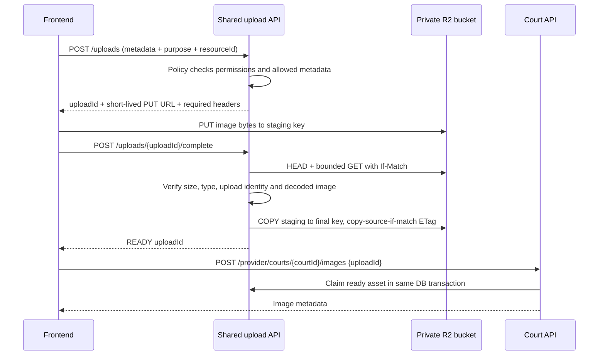

# Upload ảnh dùng chung qua Cloudflare R2

## Trách nhiệm

- `shared.upload`: ticket upload, trạng thái, kiểm tra file, storage port, dọn file bỏ dở.
- `shared.upload.r2`: adapter AWS S3 SDK cho R2 và presigned URL. Khóa chỉ ở backend.
- Module tiêu thụ triển khai `UploadPolicy`: purpose, quyền trên resource, loại file/kích thước.
- Court giữ quyền sở hữu sân, giới hạn 10 ảnh, thứ tự và ảnh đại diện. Không import SDK R2.
- Frontend `shared/uploads`: chọn file, PUT trực tiếp, progress, abort, retry; không import court.
- Frontend court chỉ truyền scope `COURT_IMAGE` và gọi endpoint gắn `uploadId` sau xác minh.



## Endpoints

Success dùng `ApiResponse`, lỗi dùng `ErrorResponse`, Bearer JWT cho API được bảo vệ.

| Method | Endpoint | Mục đích |
| --- | --- | --- |
| POST | `/api/v1/uploads` | 201: tạo lượt upload đã kiểm tra quyền |
| POST | `/api/v1/uploads/{uploadId}/complete` | 200: backend xác minh, trả READY; gọi lại an toàn |
| DELETE | `/api/v1/uploads/{uploadId}` | 204: hủy lượt chưa gắn; file được dọn theo lịch |
| POST | `/api/v1/provider/courts/{courtId}/images` | 201: gắn ảnh với JSON `{ "uploadId": "..." }` |
| GET | `/api/v1/provider/courts/{courtId}/images/{imageId}/access` | 200: URL đọc có hạn sau khi kiểm tra quyền |

POST `/uploads`:

```json
{
  "purpose": "COURT_IMAGE",
  "resourceId": "<court UUID>",
  "fileName": "court.png",
  "contentType": "image/png",
  "sizeBytes": 12345
}
```

`data` trả `uploadId`, `uploadUrl`, `method: PUT`, `headers`, `expiresAt`.
Frontend PUT file nguyên bản với đúng các header được trả. Không dùng FormData,
không dùng API client có JWT cho URL R2. Không lưu/log/share presigned URL.

Complete chỉ nhận uploadId trong path; không nhận URL, object key, bucket, size hoặc
MIME do frontend cung cấp lại để quyết định file hợp lệ. Backend tự lấy thông tin R2.

Court chỉ claim asset READY đúng actor/purpose/resource, trong transaction có khóa sân.
Gọi lại attach cùng uploadId trên cùng sân trả lại ảnh đã gắn, không thêm ảnh trùng.
Một upload không thể gắn sang sân khác, module khác hoặc tài khoản khác.

## Kiểm tra và vòng đời

- Chấp nhận PNG/JPEG, 1 byte–5 MiB; tối đa 6000 px/cạnh và 20 triệu pixel.
- HEAD xác minh size/type/upload-id/ETag; header MIME một mình không chứng minh file là ảnh.
- Backend đọc có giới hạn 5 MiB, dùng If-Match rồi decode ảnh để phát hiện file giả.
  File upload vẫn đi trực tiếp FE → R2; BE tải lại để kiểm tra, không nhận multipart.
- COPY có điều kiện đúng ETag đã kiểm tra sang key final mà frontend không có quyền PUT.
  URL PUT cũ có dùng lại cũng chỉ sửa staging, không sửa ảnh đã được chấp nhận.
- Không coi ETag là checksum SHA/MD5; ở đây ETag là điều kiện phiên bản object.
- PUT URL: 5 phút; complete/attach trong 15 phút từ lúc tạo ticket.
- PENDING → READY → ATTACHED. Hủy/xóa/hết hạn → DELETE_PENDING → DELETED.
- Xóa ảnh ghi DELETE_PENDING cùng transaction xóa liên kết; worker thử lại nếu R2 lỗi.
- Worker dọn mỗi 5 phút, tối đa 50 mục/lượt. Cấu hình lifecycle staging là bắt buộc
  để dọn file còn sót nếu client dùng lại URL PUT sau khi đã hủy hoặc đã attach.
- API có rate limit và giới hạn lượt chưa hoàn tất trên mỗi người dùng. Giới hạn đếm
  ticket là biện pháp giảm lạm dụng, không phải quota lưu trữ cloud cứng khi có request đồng thời.
- Giới hạn 5 MiB được kiểm tra trước khi cấp ticket và bằng size thật khi complete.
  Presigned PUT không được quảng cáo như cơ chế bảo đảm không thể gửi file lớn lên staging.

## Đọc ảnh và riêng tư

Bucket private; không bật r2.dev hoặc public custom domain cho bucket này.
Ảnh sân DRAFT không được đọc qua API public. API owner kiểm tra PROVIDER + sở hữu sân.
`/access` trả URL GET có hạn 60 giây; frontend fetch URL này không có JWT/cookie.
URL đã cấp có thể sử dụng trong thời hạn đó; đổi quyền không thu hồi ngay một URL đã cấp.
Endpoint `/content` cũ vẫn tồn tại: R2 trả 302 tới URL đọc có hạn; ảnh local cũ trả bytes.

## Cấu hình Cloudflare và môi trường

1. Tạo bucket **Standard**, giữ private. Không cần R2 public URL.
2. Tạo S3 API Access Key ID/Secret với quyền Object Read & Write chỉ trên bucket này.
   Không dán khóa vào chat, commit, `.env.example` hoặc biến `VITE_*`.
3. Cấu hình CORS trong bucket Settings. Thay/thêm origin deploy thật khi có frontend deploy:

```json
[
  {
    "AllowedOrigins": ["http://127.0.0.1:5173", "http://localhost:5173"],
    "AllowedMethods": ["PUT", "GET", "HEAD"],
    "AllowedHeaders": ["content-type", "x-amz-meta-upload-id"],
    "ExposeHeaders": ["ETag"],
    "MaxAgeSeconds": 300
  }
]
```

4. Tạo lifecycle rule: prefix `staging/`, xóa object sau **1 ngày**. Không áp rule này vào `assets/`.
5. Đặt biến môi trường backend rồi restart:

```dotenv
R2_ENABLED=true
R2_ENDPOINT=https://<ACCOUNT_ID>.r2.cloudflarestorage.com
R2_BUCKET_NAME=<private bucket name>
R2_ACCESS_KEY_ID=<S3 access key>
R2_SECRET_ACCESS_KEY=<S3 secret key>
```

Repo không tự đọc `.env`; dùng cấu hình môi trường của IDE/deploy hoặc import env trước
khi chạy ứng dụng. R2_ACCOUNT_ID/R2_PUBLIC_URL cũ không cần cho luồng này; endpoint đầy đủ là bắt buộc.
`R2_ENABLED=false` mặc định: upload mới trả 503, ứng dụng vẫn chạy các chức năng khác.
Bật R2 nhưng thiếu cấu hình sẽ fail lúc khởi động thay vì âm thầm lưu local.

Đối với Standard, free tier hiện gồm 10 GB-month và hạn mức request hàng tháng;
vượt hạn mức có thể phát sinh phí. Kiểm tra Usage/Billing trên Cloudflare, đặc biệt staging.
Không tạo subscription hoặc bật dịch vụ tính phí tự động từ code dự án.

## Module mới dùng lại

1. Tạo bean triển khai UploadPolicy với purpose khác, ví dụ USER_AVATAR; kiểm tra actor/resource
   của chính module và chỉ cho PNG/JPEG trong giới hạn shared.
2. Module gọi `uploads.claim(actor, uploadId, purpose, resourceId)` khi lưu liên kết,
   cùng transaction và khóa resource phù hợp; gọi `release` khi bỏ liên kết.
3. Trước khi gọi `readUrl`, module phải kiểm tra quyền xem resource.
4. FE dùng ImageUploader với scope mới và callback lưu uploadId. Không sửa code upload shared.

Phiên bản này dùng chung cho **ảnh**; chưa hỗ trợ video/PDF/multipart upload hoặc quét antivirus.

## Migration và tương thích

V16 thêm shared_upload_assets và court_images.upload_id, không sửa V10–V15 đã áp dụng.
Ảnh local cũ giữ upload_id NULL và được đọc bằng LegacyImageReader trong shared (chỉ đọc).
Upload local mới đã bị bỏ. Khi xóa metadata ảnh legacy, file cũ được giữ để rollback/migrate thủ công.
Deploy mới không có các file cũ thì phải chuyển dữ liệu legacy hoặc upload lại ảnh; chúng
không tự xuất hiện trên R2. Không xóa volume/ảnh cũ trước khi hoàn tất chuyển dữ liệu.

Đây là thay đổi contract của API ảnh trong PR court chưa merge: multipart được thay bằng
JSON uploadId. Client cũ phải được cập nhật cùng backend trước khi sử dụng phiên bản này.

## Kiểm thử

- Unit: UploadServiceTest, ImageVerifierTest, R2ObjectStorageTest, ArchitectureTest.
- Integration: UploadWorkflowIntegrationTest (PostgreSQL/Flyway/API thật; storage mock), chạy
  cùng profile integration của repo bằng Docker/Testcontainers.
- FE: test direct PUT/progress/cancel/retry và E2E complete → attach → private read → delete.
- Kiểm tra R2 thật sau khi cấu hình: xem `scripts/test-r2-upload.ps1`. Chưa có bucket/khóa
  thì test mock không được coi là chứng nhận tích hợp Cloudflare đã thành công.

## Tài liệu chính thức

- [R2 presigned URLs](https://developers.cloudflare.com/r2/api/s3/presigned-urls/)
- [R2 S3 compatibility / conditional copy](https://developers.cloudflare.com/r2/api/s3/api/)
- [R2 CORS](https://developers.cloudflare.com/r2/buckets/cors/)
- [Object lifecycle](https://developers.cloudflare.com/r2/buckets/object-lifecycles/)
- [R2 pricing](https://developers.cloudflare.com/r2/pricing/)
